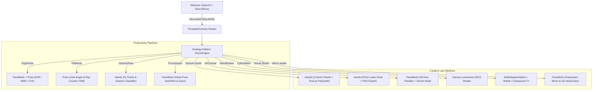

# 🌌 ErgoPulse - Edge Computer Vision & Creative Spatial Suite

> **All-in-one, privacy-first computer vision studio and real-time interactive cockpit.**  
> Built with **Python (FastAPI, OpenCV, MediaPipe, SQLite)** & **React (TypeScript, Tailwind CSS, Tone.js, WebSockets)**.

---

## 📌 Overview & 9 Integrated Vision Modules

**ErgoPulse** is an edge-native suite of real-time Computer Vision tools running 100% on-device with sub-20ms inference latency:

### 💼 Productivity & Biometrics Suite
| Module | Core Capability | Algorithms & Landmarks | Key Metrics |
| :--- | :--- | :--- | :--- |
| 🛡️ **ErgoPulse** | Posture Correction & Fatigue Prevention | MediaPipe FaceMesh & Pose (EAR, MAR, Craniovertebral Vector) | EAR, MAR, CVA Angle, 2D Kinematic Avatar |
| 🏋️ **FitMotion** | Fitness Form Analysis & Repetition Counter | MediaPipe Pose (3-point joint angle arccos, Inflection FSM) | Rep Count, Knee/Elbow Angle, Depth Quality |
| ✋ **GestureFlow** | Hand Tracking & Air Gesture Control | MediaPipe Hands (21-Landmark Mesh, Finger Extension, Pinch) | Gestures (Peace, Thumbs Up, Fist, Pinch), Finger Count (0–5) |
| 📵 **FocusGuard** | Gaze & Distraction Productivity Monitor | MediaPipe FaceMesh (3D Head Pose Estimation, Yaw & Pitch) | Focus Score (%), Gaze Angle, Phone-in-lap Suspicion |

### 🎨 Creative Computing & Audio Lab
| Module | Core Capability | Algorithms & Web Tech | Key Metrics |
| :--- | :--- | :--- | :--- |
| 🎵 **Gesture Synth** | Two-Handed Musical Synthesizer (*inspired by indecisiveeric*) | MediaPipe Hands (21 Joint Constellations) + Tone.js PolySynth | Left Hand (I-VII Chords & Minor/Major tilt), Right Hand (Voicing 1-4 & Octave), Golden Waveform |
| 🎨 **AirCanvas** | Spatial Air Drawing & Neon Laser Brush | MediaPipe Hands (Index Pinch & Tip Tracker) + HTML5 Canvas | Cyan/Magenta/Lime/Rainbow palette, Brush Size Slider, Undo & PNG Export |
| 🌌 **HoloWindow 3D** | Head-Coupled Parallax 3D Fish-Tank Window & Secret Vault | MediaPipe FaceMesh (3D Head Pose & Line-of-sight Occlusion) | Off-axis Perspective, Occluded Vault Reveal (#OMNI-7794), Head Distance cm |
| 💾 **CyberMatrix** | Real-Time ASCII Typography & Luminance Shaper | Dynamic Canvas Luminance Mapping + Monospace Matrix Render | Matrix Green, Amber CRT & Synthwave Palettes, Invert Mode |
| 🎬 **Virtual Studio** | Real-Time Neural Semantic Segmentation & Smart Bokeh | MediaPipe SelfieSegmentation (100% On-Device) + OpenCV Alpha Blending | DSLR Bokeh 85mm f/1.4, Cyberpunk Skyline, Matrix Rain, Chroma Green |
| 🤖 **Mirror Avatar 3D** | Interactive 3D Facial Avatar Mirroring | MediaPipe FaceMesh (EAR Blink, MAR Mouth Open, Smile, Eyebrow, Head Yaw/Pitch/Roll) | CyberBot, Neon Specter & Matrix Bio skins with real-time telemetry gauges |

---

## 🏗️ Architecture & Strategy Pattern

ErgoPulse uses the **Strategy Pattern** to swap computer vision pipelines on the fly without interrupting the non-blocking camera capture stream or reconnecting WebSockets.



---

## ⚡ Quick Start

### 1. Requirements
- Python 3.10+ (tested on Python 3.12)
- Node.js 18+ & npm
- Standard USB Webcam or Integrated Laptop Camera

### 2. Automated Run
Simply double-click `start.bat` on Windows:
```cmd
start.bat
```

### 3. Manual Run

#### Backend (FastAPI + OpenCV):
```bash
cd backend
python -m venv venv
# Windows:
.\venv\Scripts\activate
# Linux/Mac:
source venv/bin/activate

pip install -r requirements.txt
python main.py
```
Backend API will listen at `http://127.0.0.1:8000`.

#### Frontend (React + Vite + Tone.js):
```bash
cd frontend
npm install
npm run dev
```
Frontend cockpit will open at `http://127.0.0.1:5173`.

---

## 🔒 100% Local Privacy Guarantee
- Zero video frames, landmarks, or biometric telemetry are ever transmitted to any external server or cloud service.
- All neural networks (MediaPipe FaceMesh, Pose, Hands, SelfieSegmentation) execute locally on your machine using CPU/DirectShow acceleration.
